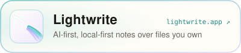

## Hey there 👋

### Who am I?
- 🌱 I love to code open-source and personal projects outside of work. This is where I learn and practice new tech to understand how it fits into enterprise-scaled ecosystems
- 🚄 I live in Japan 🏯 and love to explore the beautiful contrast of the big cities with the tranquil nature. Photography is often my excuse to motivate myself to explore

### What am I working on lately?

<p>
  <a href="https://nekkoagent.com"><picture>
    <source media="(prefers-color-scheme: dark)" srcset="./chips/nekko-agent-dark.svg">
    
  </picture></a>
  <a href="https://hypergate.app"><picture>
    <source media="(prefers-color-scheme: dark)" srcset="./chips/hypergate-dark.svg">
    
  </picture></a>
  <a href="https://vaizer.app"><picture>
    <source media="(prefers-color-scheme: dark)" srcset="./chips/vaizer-dark.svg">
    
  </picture></a>
  <a href="https://lightwrite.app"><picture>
    <source media="(prefers-color-scheme: dark)" srcset="./chips/lightwrite-dark.svg">
    
  </picture></a>
  <a href="https://getsu.app"><picture>
    <source media="(prefers-color-scheme: dark)" srcset="./chips/getsu-dark.svg">
    
  </picture></a>
</p>

- 🔭 My current, open-source focused project is [find a doc](https://github.com/ourjapanlife/findadoc-web)! Come join in!

<!---
 <br>s are fun
--->
<br><br>

```javascript
 _          _ _                            _     _  
| |        | | |                          | |   | |
| |__   ___| | | ___   __      _____  _ __| | __| |
| '_ \ / _ \ | |/ _ \  \ \ /\ / / _ \| '__| |/ _` |
| | | |  __/ | | (_) |  \ V  V / (_) | |  | | (_| |
|_| |_|\___|_|_|\___/    \_/\_/ \___/|_|  |_|\__,_|

( _\    /_ )
 \ _\  /_ / 
  \ _\/_ /_ _
  |_____/_/ /|
  (   (_)__)-)
  (  /` /.,  /
   \/  /;   /
    | === |

```
                                                   
                                                   
